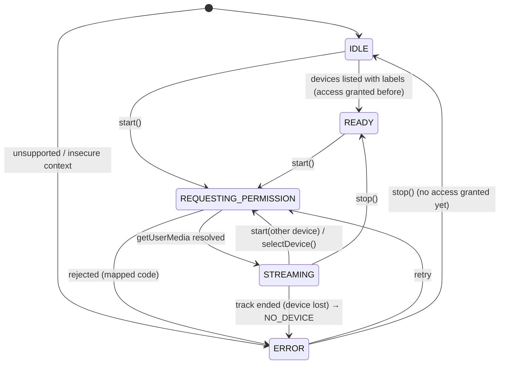

# Architecture

Summary of `docs/execution-specification.md` §3–§4 as implemented so far. The specification remains authoritative.

## Layers

| Layer         | Path                         | Responsibility                                     | Status                                    |
| ------------- | ---------------------------- | -------------------------------------------------- | ----------------------------------------- |
| Presentation  | `src/app/features/**`        | Routed pages, overlays, status, controls           | Setup page (E1); others placeholders      |
| Shared UI     | `src/app/shared/**`          | Reusable presentational components                 | `PagePlaceholder`, `MediaStreamDirective` |
| Camera        | `src/app/core/camera`        | Devices, permissions, stream lifecycle             | Done (E1)                                 |
| Frame capture | `src/app/core/frame-capture` | Scheduling, backpressure, stale-frame dropping     | Done (E1)                                 |
| Workers       | `src/app/core/workers`       | Vision worker protocol and client                  | Empty (E2/E3)                             |
| Persistence   | `src/app/core/persistence`   | IndexedDB schema, repositories                     | Empty (E7)                                |
| App state     | `src/app/core/app-state`     | Session controller / state machine                 | Empty (E6)                                |
| Domain        | `src/app/domain/**`          | Board, game, move, rules, engine — pure TypeScript | Empty (E4/E5)                             |

Dependency direction: `features → core → domain`, `features → shared`, `features → domain`. `domain` depends on nothing. `shared` depends on neither `features` nor `core`. These rules are enforced by ESLint (see ADR-006).

## Application shell

- `src/main.ts` bootstraps the standalone root `App` (`app.component.ts`) with `app.config.ts`.
- Providers: global error listeners, router with component input binding, service worker (production only).
- `App` renders header, primary navigation, `<main>` with `<router-outlet>` and footer. It contains no feature logic.
- Routes (`app.routes.ts`): `/`, `/game/new`, `/game/:id`, `/calibration`, `/games`, `/settings`, all lazy; `**` redirects to `/`.

## Camera (E1)

`CameraService` (`core/camera`, root) implements `CameraServiceContract` (spec §9) and exposes signals: `status`, `devices`, `devicesRequirePermission`, `stream`, `selectedDeviceId`, `isStreaming`.

- Browser APIs are reached only through the `CAMERA_ENVIRONMENT` token (`navigator.mediaDevices` is lint-restricted to `core/camera`).
- Before permission, browsers hide labels and often ids: such entries are not selectable and `devicesRequirePermission` is true. After the first successful stream the list is refreshed with real labels. `devicechange` refreshes it too.
- Errors are mapped to `CameraErrorCode` with pt-BR messages; raw browser messages are never shown.
- Leak guarantees: one stream at a time (released before requesting another); a request id discards any stream that resolves after a newer `start()`/`stop()` and stops its tracks; the stream is released on track `ended` and when the service is destroyed. The setup page stops camera and capture when the route is left.

## Frame capture (E1)

- `FrameScheduler` (plain TS): interval ticks; if `maxInFlight` frames are busy the tick is skipped (never queued). Frames older than `maxFrameAgeMs` or captured across a pause/stop are dropped. Every frame is released (`bitmap.close()`) in `finally`, whether processed, dropped or failed — closing a bitmap already transferred to a worker is a no-op, so the worker client in E2/E3 needs no special ownership rule.
- `VideoFrameSource`: private detached muted `<video>` on the camera stream + `createImageBitmap`; independent of the preview element.
- `FrameCaptureService` (root): wires camera stream → source → scheduler, exposes `state`, `stats`, `lastFrame`, `error`; stops automatically when the camera stream changes or closes. In E1 the processor only measures frames; E2/E3 pass the vision-worker processor to `start()`.
- Config tokens: `CAMERA_CONFIG` (1280×720 ideal, rear camera preferred) and `FRAME_CAPTURE_CONFIG` (200 ms, 1 in flight, 500 ms max age).

## Runtime principles (from spec)

1. Vision observes; engine decides.
2. Recognition never mutates authoritative game state.
3. Non-trivial image processing runs in a Web Worker.
4. No backend or cloud dependency.
