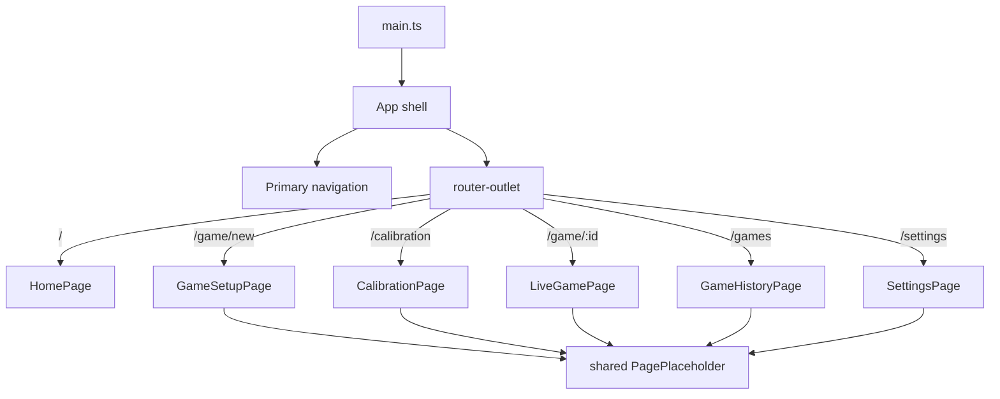

# Diagrams

The reference diagrams (component flow, vision pipeline, state machine and sequence diagrams) are maintained in `docs/execution-specification.md`:

- §3 Architecture flowchart
- §7 Vision pipeline
- §12 State machine
- §13 Sequence diagrams (calibration, initial recognition, move tracking, recovery)

Diagrams that describe the code as actually built are added here as each epic lands.

## Current shell (E0)

