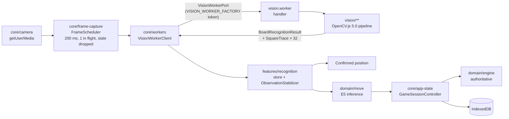

# G3.1 — Python + OpenCV vision migration: Phase 1 audit

Date: 2026-11-20. Scope: Phase 1 of the "G3.1 — Migração do Reconhecimento Visual para Python + OpenCV" directive. **No code was changed.** This report covers the current architecture and recognition, the reference prototype `anotador_damas.py`, and a proposal with its impact, plan, risks and tests.

## 0. Conflicts to resolve before Phase 2

CLAUDE.md: "If sources conflict, stop and report the conflict." Four conflicts follow.

| #   | Conflict                                                                                                                                                                                                                                                                                                                                                                                     | Sources                                                                    |
| --- | -------------------------------------------------------------------------------------------------------------------------------------------------------------------------------------------------------------------------------------------------------------------------------------------------------------------------------------------------------------------------------------------- | -------------------------------------------------------------------------- |
| C1  | **A local FastAPI service is a backend.** The spec forbids a backend for the MVP: principle 7 ("No backend or external inference API for MVP"), "Out of scope: … backend", hosting "Static HTTPS", and "Prohibited: Invent backend/cloud dependencies". CLAUDE.md repeats it. Only the user can amend the spec.                                                                              | spec §1, §2, §22 prohibitions; CLAUDE.md "Architecture"                    |
| C2  | **The project is not at G3.** G3–G8 are approved and E5–E8 are committed (`8797834`, release candidate 0.1.0-rc.1). The directive's restrictions ("do not advance to E5/E6, do not change E7") assume they do not exist. Moving recognition out of the browser would change E6's live page, E8's offline PWA, the E2E suites and the release evidence.                                       | `docs/backlog/implementation-backlog.md`, `docs/testing/release-review.md` |
| C3  | **The reported problem is not in the dataset.** The directive reports excessive `UNKNOWN` on empty squares. The only real evidence has 40 empty squares, 0 `UNKNOWN` and 0 errors. That dataset is narrow, though: 5 near-identical frames, starting position, daylight, one board. The failing condition has not been captured, so it can be neither diagnosed nor fixed from evidence yet. | `docs/vision/recognition-metrics.md`                                       |
| C4  | **Earlier, still-binding G3 restrictions:** "Não substitua componentes funcionais sem justificativa", "Não adicione dependências desnecessárias", "Não reduza os thresholds apenas para aumentar a taxa de classificação". The directive also asks not to force classifications, which the prototype does by construction (§4).                                                              | G3 directive (2026-11-19); this directive §9, §20                          |

## 1. Current architecture

All processing runs in the browser, with no server.

- **Worker protocol:** `INIT`, `CALIBRATE`, `RECTIFY_FRAME`, `PROCESS_FRAME { debug }`, `REFINE_CALIBRATION`, `RESET`, `DISPOSE` (`core/workers/vision-worker.protocol.ts`).
- **Integration point:** the client talks to a `VisionWorkerPort` created by the `VISION_WORKER_FACTORY` injection token. Tests replace it with `FakeVisionWorker`. A remote processor could implement the same port, so the stores, stabilizer, E5 and E6 would not change.
- **Existing contract:** `BoardRecognitionResult` and `SquareRecognition` already carry what the directive's `BoardObservation` and `SquareObservation` ask for:
  - occupancy, color and type;
  - per-stage confidence and `limitingStage`;
  - decision (`ACCEPT` / `WARN` / `RETRY`), reasons and warnings;
  - frame quality, timestamps and per-square traces with features.

## 2. Current recognition flow

`docs/vision/recognition.md` describes it in full. In summary:

1. Warp to 800 × 800, frame quality and denoise.
2. **A · frame assessment:** sharpness, exposure, grid alignment.
3. **Light reference:** adjacent light squares give the local illumination.
4. **Background model:** corner quadrants that match the board's typical dark square.
5. **B · occupancy:** foreground fraction of the piece disk plus a ring test.
6. **C · color:** body/background luminance ratio plus board-level consistency.
7. **D · type:** king mark on the top face, displaced away from the camera.
8. **E · consolidation:** the weakest stage sets the confidence (accept ≥ 0.80, warn ≥ 0.60, otherwise `UNKNOWN`).
9. **Page-side stabilizer:** 3 of 5 frames, leader at least 2×.

Measured cost: 46 ms median per frame (Node, real samples), under a quarter of the 200 ms interval.

## 3. Problems found

### 3.1 Code paths that turn an empty square into `UNKNOWN`

Each one is reported as a reason code in the diagnostic mode. None of them depends on the language or the binding: they are feature and threshold decisions and would behave the same in Python.

| Reason (stage)                | Trigger                                                                                                   | Likely field conditions                                                                                         |
| ----------------------------- | --------------------------------------------------------------------------------------------------------- | --------------------------------------------------------------------------------------------------------------- |
| `LOW_BOARD_CONTRAST` (B)      | background < 0.22 × light reference: a black piece could be invisible, so every **empty** square abstains | very dark playing squares (black, dark green, dark wood), dim light. **Affects every empty square at once.**    |
| `ROI_OBSTRUCTED` (background) | no corner quadrant within 0.06 chromaticity / 25 % luminance ratio of the board's typical dark square     | lighting gradient or color cast across the board, wood grain, printed squares, grid misalignment                |
| `PARTIAL_OCCUPANCY` (B)       | foreground 15–45 % of the disk                                                                            | texture or print, shadow edges, a neighbor's tall piece leaning into the disk at an oblique angle, misalignment |
| `NOT_PIECE_SHAPED` (B)        | enough foreground without the ring                                                                        | glare spots                                                                                                     |
| `RETRY` (E)                   | foreground just under 15 % → confidence 0.5–0.6                                                           | the same, milder                                                                                                |
| `MANUAL` (stabilizer)         | a full window without consensus                                                                           | any of the above, flickering                                                                                    |

### 3.2 Evaluation gaps

- **Real dataset:** 5 frames, near-duplicates of the starting position; no mid-game, no kings, no artificial light. Empty squares that held pieces earlier, and squares next to tall pieces, are not represented.
- **Configuration:** thresholds tuned and validated on one board and one lighting.
- **Next step:** a labeled sample of the failing condition, exported with **Baixar amostra rotulada**, would show which row of the table applies, from the traces.

### 3.3 Not problems

- Calibration (G2): the measured alignment is good after the automatic adjustment.
- Frame scheduling.
- Resource cleanup (soak-tested in E8).

## 4. Analysis of `anotador_damas.py`

### Useful ideas

- **Board-specific appearance calibration.** References are measured on the actual board, from a known position. The current TS pipeline is self-referenced per frame and does not learn the board's look from the confirmed position. Doing so is a valid additional evidence.
- **Lab color space** for distances.
- **Move matching:** the symmetric difference between the changed squares and each legal move's squares, accepted only on an exact match, after 1 s of stability. This is the same principle as E5, which already does it better: outcome comparison, pending removal, occlusion, ambiguity.

### Limitations

1. **It never abstains.** Each square goes to the nearest of three means, so "fewer `UNKNOWN`" holds by construction and is paid for with silent wrong readings. This violates spec principle 4 and the directive's own "não force classificações".
2. **Three global means as the only model.** One lighting gradient, a shadow or a lamp on one side shifts a dark empty square toward "black piece" with no warning: a confident error.
3. **Color references assume the standard opening** (`I`): squares 1–12 black, 13–20 empty, 21–32 white. One misplaced or missing piece corrupts the model.
4. **Tablita k-means** is initialized from the luminance extremes and median. It degenerates when a color is missing or rare, and the three clusters are assigned by order, not validated.
5. **Fixed central ROI** (40 % of the square). With an oblique camera, a tall piece's body and top face are displaced from the square center (G3's finding), so a piece can be read on a neighboring square or missed.
6. **Mean instead of a robust statistic:** specular highlights and the grid edges bias the reading.
7. **No kings**, no frame quality, no occlusion test: a hand becomes pieces or empties.
8. **No geometric validation of the corners:** order, convexity, area. Square numbering depends on the order of the clicks, with no orientation check.
9. **Fixed 640 px warp.**
10. **Undo re-reads the current board as the reference,** so a recognition error becomes truth.
11. **The engine comes from the `draughts` package,** and an AI suggests moves. An AI opponent is out of scope in the spec.
12. **Implementation:** Windows-only `winsound`, global mutable state shared with a thread, `cv2.VideoCapture` (the camera outside the browser).

## 5. OpenCV.js vs. OpenCV Python for this project

Both are the same OpenCV C++ core: OpenCV.js is that core compiled to WebAssembly. The algorithms are identical, so **accuracy does not depend on the binding**.

| Aspect                 | OpenCV.js (current)                                     | OpenCV Python (local service)                                                                                             |
| ---------------------- | ------------------------------------------------------- | ------------------------------------------------------------------------------------------------------------------------- |
| Accuracy               | same algorithms                                         | same algorithms                                                                                                           |
| Speed                  | WASM, one thread; 46 ms/frame measured (budget 200 ms)  | native SIMD and threads, faster; plus JPEG encode and transfer (≈ 5–20 ms/frame on localhost, to be measured)             |
| Deployment             | static HTTPS, PWA, offline, works on phones and tablets | Python must be installed and running on the same machine. A phone would need a PC on the LAN with HTTPS and certificates. |
| Offline / PWA          | yes, measured in E8                                     | only if the service runs locally; the PWA install no longer contains the recognizer                                       |
| Research and debugging | weaker: Node scripts, the diagnostic mode               | **stronger:** NumPy, notebooks, plots, fast iteration on samples                                                          |
| Memory                 | manual `Mat.delete()` (handled by `withResources`)      | garbage-collected                                                                                                         |
| Maintenance            | one language and contract                               | two stacks and a cross-language contract, which can drift                                                                 |
| Privacy                | frames never leave the browser                          | frames leave the browser but stay on the machine                                                                          |

**Conclusion:** Python helps the _research loop_ (experimenting with features on real samples), not the _runtime accuracy_.

## 6. Proposal

Three options, in order of recommendation.

### A — Recommended: evidence first, runtime stays in the browser

1. **Capture the failure.** Export labeled samples of the conditions where empty squares turn `UNKNOWN` (dim light, mid-game, your board), tagged by condition. They become the G3.1 dataset.
2. **Diagnose** with the existing traces: which reason code, which feature, at what value.
3. **Python vision lab, dev-only.** A `tools/vision-lab/` folder with Python, NumPy, OpenCV and pytest, not shipped. It replays the same labeled samples (same JSON format), so features can be tried quickly and the directive's feature experiments are done properly (Lab/HSV, histograms, texture, gradients, per-board references). It is optional and needs your approval as a new dev dependency.
4. **Port the selected features** to the TS stages. One idea worth evaluating comes from the prototype: **per-session board references learned from the confirmed position**, used as additional evidence, never alone.
5. **Validate** on the real samples (zero confident errors, `EMPTY` precision ≥ 98 %), regenerate the metrics and add regression scenarios.

- **Effect:** no spec change; PWA, mobile, E5–E8 and the release evidence are preserved.
- **Cost:** none of the deployment cost.

### B — Optional hybrid provider: needs a spec amendment

A local FastAPI service implements the same `VisionWorkerPort` protocol through a `RemoteVisionPort` adapter in `core/workers`. OpenCV.js stays the default and the offline fallback, and a setting selects the provider.

- **Transport:** WebSocket `ws://127.0.0.1:<port>/v1/sessions/{id}/frames`, binary JPEG frames with a JSON header, one frame in flight, stale frames dropped by the existing scheduler. Browsers treat `localhost` as trustworthy, so an HTTPS page can connect.
- **REST:**
  - `GET /v1/health`, `GET /v1/config`;
  - `PUT` / `DELETE /v1/sessions/{id}/calibration`;
  - `POST /v1/sessions/{id}/calibration/refine`.
- **Not added as endpoints:** square inspection and feature extraction. The `debug` flag returns traces (they already carry features, regions and reasons) and the rectified image, so there is no extra API surface.
- **Contract:** the existing `BoardRecognitionResult` (v1), defined in Pydantic. Its JSON Schema is checked against the TS types by contract tests on shared fixtures, and the client validates every response, since an observation is untrusted.
- **Stabilization** stays on the page, in one place, because E5 consumes it there. Python does not stabilize.
- **Python package:**
  - `api/`: routers, schemas, errors, limits, timeouts, a semaphore of 1 per session, logging;
  - `geometry/`: corner validation, warp, grid, ROIs;
  - `quality/`, `features/`;
  - `classify/`: occupancy, color and type stages, confidence;
  - `diagnostics/`.
- **Cost:** two classifiers to keep in step, or the Python one diverges. Parity tests on the real samples are mandatory.

### C — Replace the browser recognizer with Python, as the directive describes: not recommended

- It needs the same spec amendment as B.
- It loses offline use and mobile devices.
- It reopens G3 and invalidates part of E8 and the release candidate rc.1.
- Every E2E run needs the Python service running.

## 7. Impact on G2 (calibration)

- **A:** none.
- **B / C:**
  - the corner UI, the stored `Calibration` record and its IndexedDB repository stay in Angular;
  - Python must reproduce the warp and `REFINE_CALIBRATION` (in Python), or the page sends only the corners;
  - geometric validation (order, convexity, area, aspect) moves to, or is duplicated in, Python;
  - G2's tests must run against both.

## 8. Impact on G3 (recognition)

- **A:** classifier and threshold changes under the existing G3 rules (real samples, metrics, regression scenarios); G3 reopened as G3.1.
- **B:** a second recognizer, with parity and metrics for each provider.
- **C:** `src/app/vision/recognition/**`, the worker handler and their specs are replaced; G3 is redone.

## 9. Impact on G4 and later epics

- **E4 engine:** none, in every option.
- **E5 inference and E6 game:** none if the contract is identical (same `BoardRecognitionResult`, same stabilizer). B and C add one failure mode ("serviço de visão indisponível"), which must reuse the camera-error and recovery path.
- **E7 persistence:** none; no image is stored.
- **E8 release:**
  - **A:** the evidence stays valid; the metrics are regenerated.
  - **B:** the PWA remains, but the Python mode needs its own E2E, profiling and install documentation.
  - **C:** offline and PWA, profiling, `e2e:prod`, the release notes and the release review must all be redone.

## 10. Migration plan

| Phase | A (recommended)                                                              | B (if approved, with the spec amendment)                                |
| ----- | ---------------------------------------------------------------------------- | ----------------------------------------------------------------------- |
| 1     | Audit (this document)                                                        | same                                                                    |
| 2     | Your decision; you collect labeled samples of the failure                    | ADR and spec amendment v1.1; contract freeze (v1)                       |
| 3     | `tools/vision-lab` (dev only): sample loader, replay, metrics parity with TS | `vision-service/` project, FastAPI, health, config, logs, pytest        |
| 4     | —                                                                            | geometry: corners, warp, grid, ROIs, with tests against the TS fixtures |
| 5     | Feature experiments on the samples; selection documented                     | recognition stages, confidence, diagnostics                             |
| 6     | Port to the TS stages                                                        | `RemoteVisionPort`, provider setting, error mapping                     |
| 7     | Stabilizer: unchanged unless the evidence says otherwise                     | same; the stabilizer stays page-side                                    |
| 8     | Metrics on the new samples, regression scenarios, `npm run eval:recognition` | the same metrics for both providers; parity report                      |
| 9     | Gate G3.1 report                                                             | same                                                                    |

## 11. Risks

- **Fixing the wrong problem.** Without the failing samples, any migration is a guess (C3). This is the main risk for every option.
- **Trading `UNKNOWN` for errors.** Copying the prototype's nearest-mean rule would remove `UNKNOWN` by producing confident errors. Every change must keep zero confident errors on all suites.
- **Overfitting** to one board and one light: the thresholds need samples from several conditions.
- **B / C:**
  - service lifecycle (not started, crashed, wrong port);
  - contract drift between Pydantic and TS;
  - latency from JPEG encoding;
  - CORS and private-network access rules;
  - user installation on Windows;
  - two recognizers diverging.
- **Scope.** The directive also lists the AI suggestions and the `draughts` engine from the prototype; both are out of scope and would not be ported.

## 12. Test strategy

- **Dataset:** the existing labeled-sample format (`tests/fixtures/real-samples`), extended with the new conditions; ground truth comes from the user's confirmation.
- **Metrics:** the existing `recognition-metrics.ts`:
  - confusion matrix over EMPTY, WHITE, BLACK, WHITE_KING, BLACK_KING and UNKNOWN;
  - precision, recall and UNKNOWN rate, plus false positives and negatives;
  - per class, per image and per condition, with `EMPTY` first;
  - processing time added.
- **Gates kept:** zero confident errors (`recognition-accuracy`, `-empty`, `-pipeline`, `real-samples`, `recognition-metrics`), zero false commits (`move-inference`) and `npm run test:engine` green.
- **A:** vision-lab pytest (loader, replay parity with the TS results on the same samples) plus the TS suites.
- **B:**
  - pytest for geometry, ROIs, features, stages, calibration, quality and the API (FastAPI `TestClient`, validation, size limits, timeouts);
  - contract tests that load shared JSON fixtures on both sides;
  - Angular tests for `RemoteVisionPort` (fake WebSocket: drop stale, timeout, reconnect, invalid payloads);
  - Playwright with the service as a second `webServer`.
