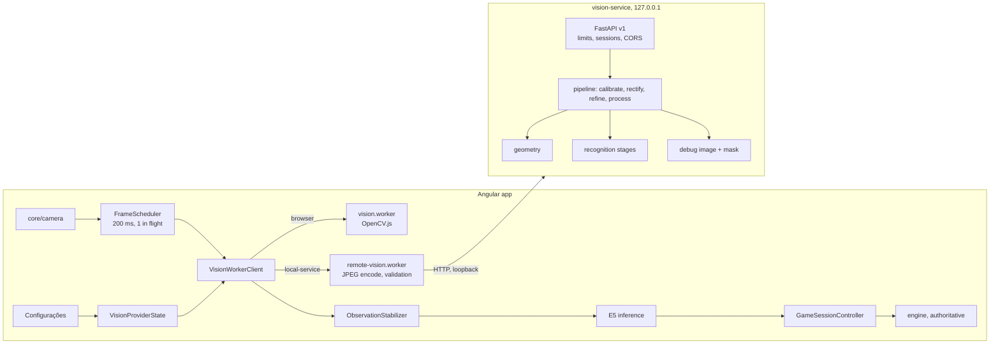

# G3.1 — Local vision service: final report

Date: 2026-11-20. Directive "G3.1 — Migração do Reconhecimento Visual para Python + OpenCV", option B (hybrid) chosen by the user, Phase 2 design approved (`g3.1-vision-service-design.md`), ADR-042. This report follows the directive's §23.

## 1. Architecture implemented

The Angular app keeps the camera, the UI, calibration, stabilization, move inference, the game and the engine. Recognition can be answered by either of two providers that speak the same vision-worker protocol and return the same contract:

- **browser** (default): OpenCV.js in a Web Worker, offline and on any device;
- **local service** (optional): Python + FastAPI + OpenCV on `127.0.0.1`, reached by a second worker (`remote-vision.worker.ts`) behind the existing `VisionWorkerPort` / `VISION_WORKER_FACTORY`.

Nothing above `core/workers` depends on the choice. The service only observes; it never sees moves, rules or games.

## 2. Diagram

## 3. Python components (`vision-service/`)

| Module                         | Responsibility                                                                                                                              |
| ------------------------------ | ------------------------------------------------------------------------------------------------------------------------------------------- |
| `api/app.py`, `api/schemas.py` | endpoints, body/image limits, per-session lock (`BUSY`), compute limit, timeouts, CORS (+ Private Network Access), logs, contract v1 models |
| `sessions.py`                  | sessions (config + calibration), idle expiry, least-recently-used eviction at the limit                                                     |
| `imaging.py`                   | magic-byte and header-size checks before decoding (decompression bombs), decode/encode                                                      |
| `geometry/`                    | board conventions, corner validation (same rules as the app), homographies, warp, grid, ROIs, corner refinement                             |
| `recognition/`                 | config validation, frame quality, grid alignment, features, background model, king-mark search, stages B–E, pt-BR traces                    |
| `pipeline.py`                  | protocol operations with error codes and timings                                                                                            |
| `scripts/evaluate.py`          | metrics report                                                                                                                              |

## 4. Angular components

| Piece                                                                 | Layer              | Role                                                                                                                         |
| --------------------------------------------------------------------- | ------------------ | ---------------------------------------------------------------------------------------------------------------------------- |
| `remote-vision.handler.ts` / `.worker.ts`                             | `core/workers`     | protocol ↔ REST, JPEG/PNG encoding off the main thread, contract validation of every answer, session recovery, error mapping |
| `vision-provider.ts`, `vision-provider.state.ts`, `vision-failure.ts` | `core/workers`     | provider types, loopback-only URL rule, central transport tuning, pt-BR failure messages                                     |
| `VISION_WORKER_FACTORY`                                               | `core/workers`     | creates the browser or the remote worker                                                                                     |
| `VisionProviderService`                                               | `core/app-state`   | loads (app initializer) and saves the choice, "Testar conexão"                                                               |
| `vision.provider` setting                                             | `core/persistence` | one additive key, no schema change (authorized in Phase 2)                                                                   |
| Settings page, recognition store, debug view                          | `features`         | recognizer section; explicit stop after 5 unanswered frames; provider label and foreground mask in the inspector             |

## 5. Contracts

The existing app types, unchanged in meaning: `VisionConfig`, `CalibrationCorners`, `CalibrationResult`, `BoardRecognitionResult` (board, squares, status, confidence, warnings), `SquareTrace` (regions, ROI quality, stage outcomes, features, reason, explanation) and `FrameAssessment`. They cover the directive's `BoardObservation`/`SquareObservation` proposal. Additions:

- protocol: the `SERVICE_UNAVAILABLE` error code and the optional `foregroundMask` bitmap;
- service response: `timings` (decode, warp, recognition, total, request bytes);
- versioning: `contractVersion: 1` checked at `INIT` and by "Testar conexão".

Kept in step by `tests/integration/vision-service-contract.spec.ts` (the browser's answers and default config exported as fixtures; the service's answer checked with the app's validators) and `vision-service/tests/test_parity.py`.

## 6. Endpoints

See `vision-service/README.md` (table) and `/openapi.json`. REST was chosen over WebSocket (design §3): one frame in flight, OpenAPI, simpler timeouts, no extra dependency; the measured round trip (§14) gives no reason to revisit it.

## 7. Recognition strategy

The service runs the same staged pipeline as the browser (quality → occupancy → color → type → consolidation), with the thresholds the app sends at session creation (one source: `classifier.config.ts`). Parity is the first requirement: two recognizers that disagree would make the provider choice change game outcomes. The implementation is vectorized with NumPy (per-square windows, cached square geometry, chromaticity computed only for candidate pixels).

## 8. Features used

Unchanged from G3 (`docs/vision/recognition.md`): RGB distance to a per-square background (median of the corners that look like the board) scaled by the local light reference, shadow/glare tolerance by chromaticity, disk and ring foreground fractions, body/background luminance ratio, board-level chromaticity consistency, and the king-mark search on the displaced top face.

**Feature study (directive §10, design Phase 5b): not done.** The reported problem (UNKNOWN on empty squares) is not in the dataset, and selecting features on synthetic boards would be tuning on fictitious data, which the G3 directive forbids. The infrastructure for it is ready (Python replay of real samples, metrics, parity); it needs labeled samples of the failing condition.

## 9. Calibration

The G2 UI and stored calibration are unchanged. The service re-validates the corners with the app's rules (order, convexity, bounds, distinctness, area), refuses frames whose size does not match the calibration, never keeps an invalid calibration, and ports the automatic corner adjustment (within 0.5 px of the browser on every sample). The normalized size comes from `VisionConfig`.

## 10. Diagnostics

The diagnostic mode works with both providers: rectified image, regions, per-square state, inspector with stage outcomes, features and explanation. With the service it also shows which recognizer answered and the **foreground mask** of the inspected square (white: differs from the background; gray: discarded as shadow or glare), produced by the service.

## 11. Metrics

`docs/vision/service-metrics.md` (`npm run vision:eval`): confusion matrix over EMPTY, WHITE, BLACK, WHITE_KING, BLACK_KING and UNKNOWN; per-class precision, recall and F1; UNKNOWN rate; occupancy false positives/negatives; per image; JPEG study; processing time.

## 12. Real results

| Set                                      |      Correct | UNKNOWN | Confident errors | EMPTY P / R    |
| ---------------------------------------- | -----------: | ------: | ---------------: | -------------- |
| Real samples, PNG, as saved              |      224/224 |       0 |                0 | 100 % / 100 %  |
| Real samples, after automatic adjustment |      224/224 |       0 |                0 | 100 % / 100 %  |
| Real samples, JPEG 95 / 90 / 80 / 70     | 224/224 each |       0 |                0 | 100 % / 100 %  |
| Synthetic boards (31, not evidence)      |      956/992 |      36 |                0 | 100 % / 95.0 % |

Every square of every set matches the browser recognizer (parity tests). The synthetic UNKNOWNs are the adversarial EMPTY scenarios (glare, a hand, a phone, a very dark shadow), where abstaining is the expected answer. Kings: 33/33 on synthetic boards; **not measured on real pieces**.

## 13. Tests

- **Python (pytest, 87):** geometry, ROIs, features, stages, config validation, numerics, API (validation, 409/413/415/422/503/504, sessions, eviction, busy, timeout, CORS), parity on 5 real samples × 3 and 31 synthetic boards.
- **Angular (Vitest):** remote handler (17), provider and factory (14), recognition store with the service (3), settings page (1), contract spec (8); whole suite green (see the validation results).
- **E2E (`npm run e2e:service`, 4):** settings → calibration (preview, automatic adjustment) → recognition → diagnostics with mask → correction → confirmation through the service; camera-detected moves of a game through the service; an unreachable service reported with no OpenCV.js fallback; profiling.
- **Existing suites:** `npm run validate`, `npm run e2e`, `npm run e2e:prod`, unchanged and green.

## 14. Performance (this machine)

| Measure                                         | Result                  | Target            |
| ----------------------------------------------- | ----------------------- | ----------------- |
| Service processing, real 1280 × 720 JPEG frames | median 42 ms, p90 62 ms | ≤ 50 / ≤ 80 ms    |
| Frames recognized in the browser                | 5.1 /s                  | 5 /s              |
| Round trip per frame (network)                  | median 40 ms, p90 47 ms | p90 ≤ 150 ms      |
| Payload (640 × 480 E2E camera, JPEG 0.9)        | 21 kB                   | ≤ 400 kB          |
| Service memory over 45 s                        | 68.3 → 68.7 MB          | flat              |
| Automatic corner adjustment                     | 4.4 s                   | — (browser 1.2 s) |

Sources: `docs/vision/service-metrics.md`, `docs/testing/service-performance.md`. The first port took 110 ms per frame and 8.2 s per adjustment; profiling led to the vectorization above, with parity re-checked after each change.

## 15. Known issues

- **Corner adjustment is slower than in the browser** (4.4 s against 1.2 s): the search makes thousands of small grid evaluations, where NumPy's per-call overhead dominates. It is on demand, under a 10 s limit.
- **Closed tabs do not always close their session:** a worker terminated with the page cannot send the DELETE. The remote worker gets a 1 s grace period on normal page changes, and the service evicts the least recently used idle session at its limit of 4 and expires idle sessions after 10 min.
- **Two recognizers to keep equal:** every classifier change must be made in TypeScript and Python; the parity tests fail otherwise.
- The JPEG study uses OpenCV's encoder, not Chromium's; the E2E runs use Chromium's (JPEG 0.9) without errors.

## 16. Limitations

- **The reported field problem is not demonstrated as fixed:** the dataset has no UNKNOWN on empty squares with either recognizer. The two samples sent on 2026-11-20 (a starting position and a game in progress, with empty squares where pieces stood) read 32/32 as well: over 7 frames, the 56 empty squares have 0 % foreground, confidence 1 and all four corners matched, far from every UNKNOWN path of §3.1 of the audit. Recognition logic is unchanged; the service gives the same answers as the browser.
- Real kings, artificial light, occlusion and other boards and cameras remain unmeasured (as in G3/G8).
- Measured on one Windows machine, desktop Chromium, dev server. An HTTPS deployment calling the service (Chromium local-network permission) is configured but not tested.
- No Python linter or type checker (not in the approved dependencies). Starlette 1.10 warns that `httpx` is deprecated for its test client (filtered; dev only).
- The service is for a computer that can run Python; phones and tablets use the browser recognizer.

## 17. Evidence

`docs/vision/service-metrics.md`, `docs/testing/service-performance.md`, `tests/fixtures/contract/` (browser answers, default config, service answer), `vision-service/tests/`, `tests/e2e-service/`, the audit (`g3.1-python-vision-audit.md`) and the design (`g3.1-vision-service-design.md`).

## 18. Gate G3.1 status: approved (2026-11-20)

Approved by the user with the limitations of §16: the reported failure on empty squares is not captured in the dataset (7 real frames, all read correctly).

| Criterion (directive §22)                                 | Status                                                                                                                     |
| --------------------------------------------------------- | -------------------------------------------------------------------------------------------------------------------------- |
| Python service functional                                 | Done                                                                                                                       |
| API documented                                            | Done (OpenAPI, README)                                                                                                     |
| Angular integrated                                        | Done (provider, settings, diagnostics, failures)                                                                           |
| Calibration functional, rectification validated           | Done (parity, E2E)                                                                                                         |
| ROIs correct                                              | Done (parity of every region; drawn in the diagnostic view)                                                                |
| Empty squares, white and black pieces recognized          | Done on the available real samples (224/224, 7 frames incl. a game in progress); **the failing condition is not captured** |
| Kings evaluated                                           | Synthetic only (33/33); real kings not measured                                                                            |
| Confidence documented                                     | Done (same documented model, `recognition.md` stage E)                                                                     |
| Diagnostics implemented                                   | Done (incl. the foreground mask)                                                                                           |
| Dataset structured, metrics implemented                   | Done                                                                                                                       |
| Tests pass                                                | Done                                                                                                                       |
| Performance measured                                      | Done (targets met except the adjustment's speed relative to the browser)                                                   |
| No regression in earlier epics                            | Done (all existing suites green)                                                                                           |
| Observations cannot change the game; engine authoritative | Done (unchanged chain; contract validation of every service answer)                                                        |

**What would close the directive's purpose:** labeled samples exported in the conditions where empty squares turn UNKNOWN. With them, the Python lab can study features on real evidence; any adopted change goes to both recognizers.
