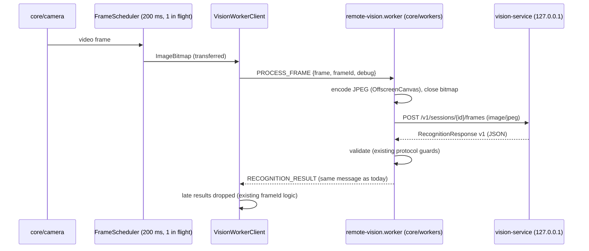

# G3.1 — Local vision service: Phase 2 architecture

Date: 2026-11-20. Option B of the Phase 1 audit (`g3.1-python-vision-audit.md`), chosen by the user: an **optional** local Python + OpenCV service that implements the existing vision-worker protocol. The browser recognizer (OpenCV.js) remains the default and the offline fallback. The deviation from spec principle 7 is recorded in ADR-042.

**Status: approved by the user on 2026-11-20 and implemented; see `g3.1-report.md` for what was built, measured and changed (session eviction, dispose grace period, `requestBytes` in the timings).**

## 1. Principles

1. **Same contract, new provider.** The service answers the same requests (`INIT`, `CALIBRATE`, `RECTIFY_FRAME`, `PROCESS_FRAME`, `REFINE_CALIBRATION`, `RESET`, `DISPOSE`) with the same results (`CalibrationResult`, `BoardRecognitionResult`, `SquareTrace`, `FrameAssessment`).
   - Unchanged: the stores, the stabilizer, E5 inference, E6 and the engine.
   - Unchanged: G2's calibration UI and record.
2. **Observation only.** The service knows nothing about moves, rules or games. It returns observations, and the page validates every response as untrusted.
3. **One stabilizer.** Temporal consolidation stays on the page (`ObservationStabilizer`), because E5 consumes it there. The service is stateless per frame; it keeps only the session's calibration and config.
4. **Single source for thresholds.** The page already sends `VisionConfig.classifier` at `INIT`, and the service validates and uses it. Thresholds stay in `classifier.config.ts`; the service only adds the limits of its own transport.
5. **No silent fallback.** If the service is unreachable, the page says so and offers to retry or to switch to the browser recognizer.

## 2. Image flow



- **Where the adapter goes.** `remote-vision.worker.ts` is a second worker behind the existing `VisionWorkerPort` / `VISION_WORKER_FACTORY`. The factory picks the worker from the provider setting (§7).
  - **Why a worker:** JPEG encoding and response parsing stay off the main thread (spec: "no non-trivial image processing on main thread"), and bitmaps are transferred and closed exactly as today.
- **Backpressure:** the scheduler keeps one frame in flight and drops stale frames. The service also refuses a second concurrent frame per session with `409 BUSY`, which the worker reports as a dropped frame. Nothing queues.
- **Encoding:** JPEG, at the camera resolution (1280 × 720 measured; no downscaling, the far rows need it). Quality comes from a central config (default 0.9).
  - Phase 8 measures the effect of JPEG on the metrics by replaying the PNG samples at several qualities.
  - The service also accepts PNG, which the tests and parity checks use.

## 3. Transport: REST, not WebSocket

| Criterion                        | REST (chosen)                                     | WebSocket                                   |
| -------------------------------- | ------------------------------------------------- | ------------------------------------------- |
| One frame in flight every 200 ms | adequate; keep-alive on localhost adds about 1 ms | no gain without pipelining, which we forbid |
| OpenAPI documentation (required) | complete                                          | not described by OpenAPI                    |
| Timeouts, errors                 | per request (`AbortController`, HTTP status)      | to be built on top of the socket            |
| Dependencies                     | `uvicorn` alone                                   | `websockets` or `wsproto` in addition       |
| Tests                            | FastAPI `TestClient`                              | more complex                                |

WebSocket is reconsidered only if Phase 8 measures a transport overhead that matters.

## 4. API (v1)

Bound to `127.0.0.1` only. Base path `/v1`. OpenAPI is served at `/docs` and `/openapi.json`.

| Method and path                             | Request                                                    | Response                                                   | Maps to protocol     |
| ------------------------------------------- | ---------------------------------------------------------- | ---------------------------------------------------------- | -------------------- |
| `GET /v1/health`                            | —                                                          | `{status, serviceVersion, contractVersion, opencvVersion}` | (before `INIT`)      |
| `POST /v1/sessions`                         | `{config: VisionConfig}`                                   | `201 {sessionId, contractVersion}`                         | `INIT`               |
| `DELETE /v1/sessions/{id}`                  | —                                                          | `204`                                                      | `DISPOSE`            |
| `PUT /v1/sessions/{id}/calibration`         | `{corners, width, height}`                                 | `CalibrationResult`                                        | `CALIBRATE`          |
| `DELETE /v1/sessions/{id}/calibration`      | —                                                          | `204`                                                      | `RESET`              |
| `POST /v1/sessions/{id}/calibration/refine` | `{corners, image: base64 PNG/JPEG}` (on demand, about 1 s) | `{corners, scoreBefore, scoreAfter, maxShiftPx}`           | `REFINE_CALIBRATION` |
| `POST /v1/sessions/{id}/rectify`            | `image/jpeg` or `image/png` body                           | `image/jpeg` (rectified)                                   | `RECTIFY_FRAME`      |
| `POST /v1/sessions/{id}/frames?debug=`      | `image/jpeg` or `image/png` body, `X-Frame-Id` header      | `RecognitionResponse` (below)                              | `PROCESS_FRAME`      |

- **`RecognitionResponse`:** `{frameId, result: BoardRecognitionResult, traces: SquareTrace[], frame: FrameAssessment, timings: {decodeMs, warpMs, recognizeMs, totalMs}}`.
  - With `debug=true` it adds `debugImage` (the rectified image, base64 JPEG) and `foregroundMask` (base64 PNG, 1 bit per pixel of the normalized board), which the inspector shows next to each square's regions.
  - The directive's `BoardObservation` and `SquareObservation` are covered by these existing types, field by field: occupancy, color and type decisions; per-stage confidence; `limitingStage`; reasons; features; ROI geometry; warnings; frame quality; timings.
  - `contractVersion: 1` is checked at `INIT`; a mismatch is an `INIT_FAILED` error.
- **Not exposed:** "inspect one square" and "extract features" endpoints. Every frame's traces already carry each square's regions, features, stage outcomes and reasons, so separate endpoints would duplicate them.
- **Error body:** `{code, message}`. The codes are the protocol's (`INVALID_REQUEST`, `NOT_INITIALIZED`, `NOT_CALIBRATED`, `CALIBRATION_FAILED`, `RECTIFY_FAILED`, `RECOGNITION_FAILED`, `REFINE_FAILED`) plus `BUSY` (409), `PAYLOAD_TOO_LARGE` (413), `UNSUPPORTED_MEDIA` (415) and `TIMEOUT` (504). The worker maps each one to the existing `ERROR` message.

## 5. Service limits and safety

All values are centralized in `settings.py` and can be overridden by environment variables.

| Limit                  | Default                                                                                      |
| ---------------------- | -------------------------------------------------------------------------------------------- |
| Bind address           | `127.0.0.1` (never `0.0.0.0`)                                                                |
| Allowed origins (CORS) | `http://localhost:4200`, `:4300` (E2E), `:4400` (serve-dist); configurable                   |
| Max body               | 8 MB                                                                                         |
| Image                  | JPEG or PNG, checked by magic bytes; 320–4096 px per side                                    |
| Sessions               | at most 4; idle TTL 10 min                                                                   |
| Concurrency            | one frame per session (lock) → `409 BUSY`; a global worker pool of 2 threads                 |
| Processing timeout     | 2 s per frame (10 s for refine) → `504`                                                      |
| Logs                   | standard `logging`, one line per request (session, frame, status, timings); never image data |

**Production origin.** A page served over HTTPS may call `http://127.0.0.1`: browsers treat localhost as trustworthy. Chromium may ask for "local network access" permission. Documented; tested in E2E with the dev origin.

## 6. Python package

```text
vision-service/
  pyproject.toml            project metadata, pytest config, requires-python ">=3.11,<3.14"
  requirements.txt          runtime pins (exact)
  requirements-dev.txt      test pins (exact)
  src/damas_vision_service/
    __main__.py             `python -m damas_vision_service` → uvicorn on 127.0.0.1
    settings.py             limits, origins, timeouts (typed, env overrides)
    api/                    app factory, routes (health, sessions, calibration, frames), schemas (contract v1), errors
    sessions.py             registry, TTL, per-session lock
    imaging.py              byte validation, decode, encode
    geometry/               corner validation, homography, warp, grid (index ↔ row/column ↔ playable), regions (ROIs)
    calibration_refine.py   port of vision/calibration-refinement.ts
    recognition/            config (from the client's VisionConfig), quality, alignment, background, features,
                            top_face, stages (occupancy, color, piece_type, consolidate), recognize, trace (pt-BR explanations)
    diagnostics.py          debug image and foreground mask
  tests/                    unit (geometry, regions, features, stages, calibration, quality), api, real samples, parity
```

- **Pipeline:** the same staged design as the browser (quality → occupancy → color → type → consolidation), with the same documented confidence (`docs/vision/recognition.md`, stage E).
  - **Phase 5:** port the pipeline and prove parity.
  - **Phase 5b:** feature experiments (Lab/HSV, histograms, texture/variance, gradients/edge density, per-session board references learned from the confirmed position), on real samples, documented in `docs/vision/feature-study.md`.
  - A feature is adopted only when it improves the metrics with zero confident errors. Every adopted change is then ported to the browser recognizer too, so the two providers stay equal.
- **Not used:** Docker (no benefit for a local Windows workflow), ML, cloud.

## 7. Angular integration

| Piece                                       | Layer               | Change                                                                                                                                         |
| ------------------------------------------- | ------------------- | ---------------------------------------------------------------------------------------------------------------------------------------------- |
| `remote-vision.worker.ts` (+ handler, spec) | `core/workers`      | new: protocol ↔ REST, JPEG encoding, response validation, timeouts                                                                             |
| `VISION_WORKER_FACTORY`                     | `core/workers`      | chooses the browser or the remote worker from the provider                                                                                     |
| `vision-provider.ts`                        | `core/workers`      | typed config `{kind: 'browser' \| 'local-service', url, jpegQuality}`, defaults in one place                                                   |
| Provider setting                            | `core/persistence`  | **one new, additive key** `vision.provider` in `SettingValues` (no schema change, no migration). It touches E7 code; needs your authorization. |
| Settings page                               | `features/settings` | provider choice, URL, "Testar conexão" (health)                                                                                                |
| Recognition, calibration, live pages        | `features`          | unchanged, except an error message with "Usar reconhecimento do navegador" when the service is down, and the foreground mask in the inspector  |

## 8. Calibration (G2) in the service

- Corners still come from the G2 UI, already canonical. The service **re-validates** them: four distinct points, convex, clockwise, minimum area and side length, aspect within limits.
- The normalized size comes from the `VisionConfig` (800 × 800 today). It is configurable, not fixed.
- An invalid calibration is returned as `valid: false` with issues and is never used.
- The stored `Calibration` record and its repository do not change.

## 9. Performance targets (to be measured in Phase 8)

| Measure                                                  | Target                                |
| -------------------------------------------------------- | ------------------------------------- |
| Service processing per frame (decode + warp + recognize) | median ≤ 50 ms, p90 ≤ 80 ms           |
| Round trip (encode + HTTP + process + parse)             | p90 ≤ 150 ms (interval 200 ms)        |
| Payload per frame                                        | ≤ 400 kB at quality 0.9               |
| Frames in flight                                         | ≤ 1; queue 0                          |
| Service memory over 30 min                               | flat (±10 %)                          |
| Main-thread heap and tracks/workers after leaving pages  | as E8 (flat; no live track or worker) |

## 10. Tests

- **Python (pytest):**
  - unit tests for geometry, ROIs, features, stages, quality and calibration;
  - API tests with `TestClient`: validation, 413/415/409/504, sessions, CORS;
  - replay of `tests/fixtures/real-samples` (the same JSON files);
  - **parity:** a TS script exports the browser results for every sample, and pytest compares them square by square (decisions identical, features within tolerance).
- **Contract:**
  - TS validates JSON produced by the service, stored under `tests/fixtures/contract/`, with the existing protocol guards;
  - pytest validates the same files with the Pydantic models.
- **Angular (Vitest):** remote worker handler with a fake `fetch` (encoding, timeouts, `BUSY` as a drop, invalid payloads, error mapping), factory selection, settings, the "service down" message.
- **E2E (Playwright):**
  - `playwright.service.config.ts` starts the service as a second `webServer`;
  - it runs calibration, recognition (board video), the diagnostic mode, manual correction and one camera-detected move with `local-service`;
  - it asserts "no live tracks" after each lifecycle change;
  - npm script `e2e:service`.
- **Existing suites:** unchanged and green, including the zero-confident-errors and zero-false-commits suites and `test:engine`.

## 11. Commands to add

- `npm run vision:setup` creates `vision-service/.venv` and installs the pins (Node script, Windows and POSIX).
- `npm run vision:serve`.
- `npm run vision:test`.
- `npm run e2e:service`.
- `npm run validate:all`: `validate` plus `vision:test`. `validate` itself stays Node-only, so the browser build works without Python.

## 12. Dependencies (new, exact pins, Python 3.11.9 present)

| Package                  | Version      | Use                                                                                            |
| ------------------------ | ------------ | ---------------------------------------------------------------------------------------------- |
| `fastapi`                | 0.165.0      | API, OpenAPI, validation                                                                       |
| `uvicorn`                | 0.54.0       | ASGI server (plain, without `[standard]`)                                                      |
| `pydantic`               | 2.14.4       | contract v1 models                                                                             |
| `numpy`                  | 2.4.6        | arrays                                                                                         |
| `opencv-python-headless` | **5.0.0.93** | the same OpenCV major and minor as OpenCV.js 5.0.0, for parity (5.1.0.95 is newer; not chosen) |
| `pytest` (dev)           | 9.2.0        | tests                                                                                          |
| `httpx` (dev)            | 0.28.1       | required by FastAPI's `TestClient`                                                             |

The transitive pins (Starlette and others) are frozen into `requirements.lock` after installation and recorded in `decisions.md`. A linter or type checker for Python (`ruff`, `mypy`) is not included; it can be proposed separately.

## 13. Gate G3.1 criteria

The directive's §22, plus:

- **Parity:** the service matches the browser recognizer on every real sample: same decisions, zero confident errors.
- **The reported problem:** improvement on empty squares can be **shown only on real samples of the failing condition**. Without them, G3.1 can show parity and the infrastructure, not the improvement. This will be stated as such.
- **No regression:** the browser provider, PWA/offline, E5–E8 suites.
