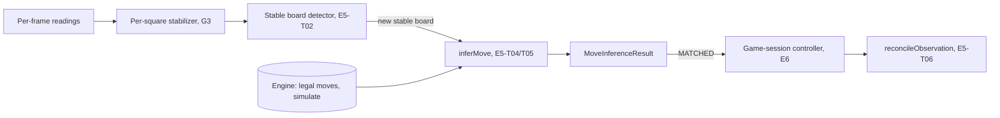

# Move inference

Implements `docs/execution-specification.md` §7 "Temporal stabilization", §8 (move inference and reconciliation) and §16 targets. Epic E5; code in `src/app/domain/move/` (pure TypeScript). Committing moves, the game state machine and the UI belong to E6.

The MVP never tracks a piece's trajectory. It compares the authoritative position (engine) with a **stable** observed board, through the outcomes of the legal moves. Vision only proposes; the engine decides.

## Chain

`MoveTracker` wires the detector and the inference, once per (authoritative position, player to move, stable board) (E5-T07).

## Stabilization (E5-T01, T02)

- **`ObservationWindow`:** at most `windowSize` observations, none older than `maxAgeMs` relative to the newest. A late (older) frame is stale and dropped, never reordered.
- **`StableBoardDetector`:** the board is stable when the latest `stableObservationCount` observations have identical cells (UNKNOWN included, so an occluded square must stay occluded) and span at least `minStableMs`. A stable board carries each square's lowest confidence over the run. It is reported as new once, and again only after another board was stable in between. Unstable observations are never forwarded.

| Config (`inference.config.ts`) | Generic default | App chain (`PIPELINE_INFERENCE_CONFIG`) |
| ------------------------------ | --------------: | --------------------------------------: |
| `windowSize`                   |               5 |                                       5 |
| `maxAgeMs`                     |         2000 ms |                                 2000 ms |
| `stableObservationCount`       |               3 |                                       2 |
| `minStableMs`                  |          500 ms |                                  200 ms |
| `acceptableConfidence`         |            0.80 |                                    0.80 |
| `maxPartialMismatches`         |               2 |                                       2 |

In the app the detector's input is already consolidated per square by the G3 stabilizer (a reading changes only when ≥ 3 of the last 5 frames agree and lead 2:1). Requiring 3 identical boards over 500 ms on top of that doubles the latency, which the measurements below show. The generic defaults are for raw, unconsolidated observations.

## Board comparison (E5-T03)

`compareObservedBoard(expected, observation)` returns the matched, mismatched and UNKNOWN playable squares, `consistent` (no mismatch on a known square), `exact` (consistent and nothing unknown) and a score (Σ confidence of the matched squares / 32). **UNKNOWN is uncertainty, never a mismatch.**

## Inference (E5-T04, T05)

`inferMove(authoritativeBoard, player, observation, engine)` follows spec §8:

1. If the observation agrees with the authoritative board on every known square → `NO_MATCH` / `BOARD_UNCHANGED` (no move happened).
2. For every legal move: simulate it, then compare.
   - Each square the move changes must be observed as expected. Exceptions: a captured piece still there (pending removal), an UNKNOWN square (occlusion), or a promoting man not crowned yet.
   - Any other value on a changed square **excludes** the move. At least one changed square must confirm it.
   - Squares the move does not change may contradict the expected board at most `maxPartialMismatches` times (misreads); beyond that, the move is excluded.
3. Each surviving candidate is `EXACT`, `PENDING_REMOVAL`, `OCCLUDED` or `PARTIAL`. Candidates are sorted by match class, then mismatches, then score.
4. Resolution:

| Situation                                                | Status                       | Warning                       |
| -------------------------------------------------------- | ---------------------------- | ----------------------------- |
| One `EXACT` candidate, no other plausible one, confident | `MATCHED` (selected)         | `PROMOTION_NOT_MARKED` if so  |
| Same, but a changed square below `acceptableConfidence`  | `REQUIRES_MANUAL_CORRECTION` | `LOW_CONFIDENCE`              |
| An `EXACT` candidate and another plausible one           | `AMBIGUOUS`                  | `SEVERAL_MOVES_MATCH`         |
| Captured pieces still on the board                       | `WAITING_FOR_STABILITY`      | `CAPTURED_PIECES_NOT_REMOVED` |
| Changed squares under a hand or object                   | `WAITING_FOR_STABILITY`      | `DECISIVE_SQUARES_UNKNOWN`    |
| Only pieces gone (a piece in the hand)                   | `WAITING_FOR_STABILITY`      | `PIECES_REMOVED_ONLY`         |
| Only `PARTIAL` candidates                                | `REQUIRES_MANUAL_CORRECTION` | `PARTIAL_MATCH`               |
| No legal outcome fits (illegal move, misread board)      | `NO_MATCH`                   | `NO_LEGAL_MOVE_MATCHES`       |

Only `MATCHED` may be committed without asking. Everything else waits, asks for confirmation or leads to reconciliation (E6): **a false commit is worse than a question.**

## Capture reconciliation (E5-T06)

`reconcileObservation(expectedBoard, observation, lastMove, boardBefore)` checks the physical board after a commit:

- `RECONCILED`: it matches.
- `PENDING_REMOVAL`: the only differences are captured pieces still on the board. Ask the player to remove them.
- `PENDING_PROMOTION_MARK`: the promoted man is not crowned yet.
- `OCCLUDED`: something covers the board; wait.
- `MISMATCH`: anything else, and the controller enters `RECONCILIATION_REQUIRED` (E6).

## Idempotency (E5-T07)

- The detector reports a stable board as new once, and the tracker infers once per (authoritative position, player, stable board). Twenty frames of the same board give one inference.
- After a commit the authoritative position changes, and the same physical board now matches it (`BOARD_UNCHANGED`), so a repeated frame can never commit a move twice.
- `reset()` starts over after a pause, recalibration or correction.

## Measured (synthetic, 2026-11-19)

These measurements come from `tests/integration/move-inference.spec.ts`. It plays 30 seeded random games, 1,356 moves (434 captures, 45 promotions), frame by frame at 200 ms, through the app's chain: per-frame readings → G3 stabilizer → tracker.

- **Each physical move:** hand over the piece → piece lifted → placed with the captured pieces still on the board → captured pieces removed one by one → 1–3 s still.
- **Noise:** 15 % of frames have an UNKNOWN square, and 5 % have a misread piece.

| Config                            | Inferred automatically | False commits | Latency, median / p90 |
| --------------------------------- | ---------------------: | ------------: | --------------------: |
| Generic (3 boards / 500 ms)       |    1345 / 1356 (99.2%) |             0 |         1.2 s / 1.2 s |
| **App chain (2 boards / 200 ms)** | **1356 / 1356 (100%)** |         **0** |     **0.8 s / 0.8 s** |

Latency runs from the frame where the move's squares are visible and settled to `MATCHED`. The test asserts zero false commits, ≥ 98 % inferred and a median ≤ 1 s (spec §16).

Synthetic sequences validate the logic, not field behavior. Real games (E8-T02 physical test matrix) will measure the real rates: slow and fast moves, hands lingering over the board, capture removal delay, and misreads that persist over several frames.

## Limitations

- **A persistent misread** (one that survives the G3 stabilizer) on a square the move does not change gives a `PARTIAL` match and asks for confirmation. On a changed square it excludes the move, so the board needs correcting.
- **Stacked or unmarked kings** read as men, so a promotion is accepted with `PROMOTION_NOT_MARKED`. A move by an unmarked king reads as a man moving, which matches no legal king move: `NO_MATCH`, and the user corrects it.
- **Two moves with the same visible outcome** cannot be told apart. The engine already merges flying-king paths with the same result; anything else is reported as `AMBIGUOUS`.
