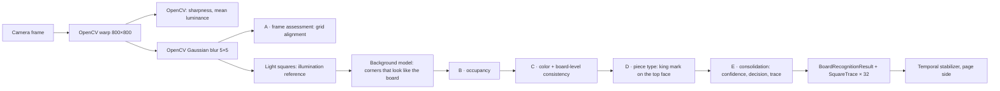

# Recognition

Implements `docs/execution-specification.md` §5 (Recognition), §7 (MVP recognition, Frame quality), §9 (`PROCESS_FRAME`), §10 (manual correction) and §14. Epic E3, refactored in Gate G3 (ADR-030 to ADR-036).

Recognition observes; it never changes game state (ADR-025). A square it cannot decide safely is `UNKNOWN`, never a guess.

## Pipeline (vision worker)

The `FrameScheduler` from E1 drives recognition: one frame in flight, a 200 ms interval, stale frames dropped. The page sends the saved calibration again whenever the frame size changes. When it calibrates, the worker also derives the direction in which tall pieces appear displaced (see Stage D).

## Regions (per playable square, normalized image)

All regions derive from the calibrated square size `s` (`vision/recognition/square-regions.ts`). The diagnostic view draws these same regions from the worker's traces, so the ROI shown is the ROI used.

| Region           | Definition                                                 | Used for                                         |
| ---------------- | ---------------------------------------------------------- | ------------------------------------------------ |
| Area             | square minus a 3 % margin per edge                         | everything below (grid lines excluded)           |
| Corners          | distance from center ≥ 0.47 s, split into four quadrants   | background model                                 |
| Piece disk       | distance ≤ 0.30 s                                          | foreground fraction (occupancy)                  |
| Occupancy ring   | 0.21 s – 0.30 s (outer 30 % of the disk radius)            | piece-shaped test                                |
| Body ring        | 0.16 s – 0.30 s, foreground pixels only                    | piece color                                      |
| King-mark search | line from the center, 0.7 s away from the camera, ± 0.22 s | king mark (Stage D)                              |
| Light-square ROI | light square inset by 15 % per edge                        | local illumination reference, suspicious squares |

## Stages

**Light reference.** Light squares never hold pieces. The median luminance of the 2–4 orthogonally adjacent light squares (suspicious ones excluded) is the local illumination reference; every luminance threshold below is relative to it.

**Background model.** Each corner quadrant is a board-background candidate when its chromaticity is within 0.06 of the board's typical dark square and its luminance/light ratio within 25 % of the typical ratio. The square's background is the median of the matching corners. A piece or object covering some corners no longer corrupts the background; when no corner matches, the square is `UNKNOWN` (`ROI_OBSTRUCTED`).

**Foreground test.** A disk pixel is foreground when its RGB distance from the background exceeds `0.12 × light reference`, unless it keeps the background's chromaticity (≤ 0.04) with a luminance between 0.45× and 1.35× the background's: that is the board in shadow or under glare, not an object.

**A · Frame assessment** (advisory, spec §7). Sharpness (Laplacian variance < 15), exposure (mean luminance < 0.12 or > 0.92) and grid alignment: for each internal grid line, the luminance contrast on the line relative to the best contrast within ±0.4 square. Below 0.5 the frame raises `CALIBRATION_MISALIGNED` ("Reajustar cantos").

**B · Occupancy.** Decided before, and independently of, color and type.

- `EMPTY` when the foreground is ≤ 15 % of the disk. If the background is darker than 22 % of the light reference, a black piece could be invisible, so it becomes `UNKNOWN` (`LOW_BOARD_CONTRAST`).
- `OCCUPIED` when the foreground is ≥ 45 % **and** reaches the disk edge all around: occupancy ring ≥ 50 %. A piece covers its disk to the edge; a glare spot or a fingertip covers the center only (`NOT_PIECE_SHAPED` → `UNKNOWN`).
- `UNKNOWN` in between (`PARTIAL_OCCUPANCY`: off-center piece, finger, misalignment).

**C · Color.** The body/background luminance ratio: white at ≥ 1.5, black at ≤ 0.65, `UNKNOWN` in between. Both regions share the same lighting. Board level: with ≥ 3 white pieces, a "white" whose body chromaticity departs by more than 0.05 from the median of the others is not a piece (hand, object): `INCONSISTENT_PIECE_COLOR` → `UNKNOWN`, plus an `UNEXPECTED_OBJECTS` warning.

**D · Piece type.** Kings carry a colored mark (spec §7). An oblique camera sees a tall piece's top face, where the mark is, projected **away from the camera**, by up to 0.6 square in the far rows. The direction comes from the calibration: the far edge of the board is the shortest in the camera image (`top-face.ts`, `awayFromCamera`; boards seen from above search only the center). The mark is searched along that line. A mark pixel:

- is bright enough (≥ 0.22 × light reference) to have a reliable color;
- differs in chromaticity from the body (≥ 0.08);
- cannot be explained as a mix of two of {body, square background, light square, neutral gray}, within 0.04. Blurred edges against the board and board reflections on glossy pieces are such mixes.

Coverage is the largest number of mark pixels in one disk of 1.5 mark radii slid along the line, relative to the expected mark area (π × (0.1 s)²). `KING` at ≥ 0.4, with a soft margin of 0.25.

**E · Consolidation.** Each stage gives a confidence: 0.5 at its threshold, rising linearly to 1 at its soft margin. These are heuristic values, not probabilities. The square's confidence is the weakest stage, and that stage is recorded as `limitingStage`. Below 0.60 (or undetermined) the square is `UNKNOWN` (`RETRY`); below 0.80 it is accepted with a warning (`WARN`). The bands are spec §7's: high ≥ 0.95, acceptable ≥ 0.80, uncertain ≥ 0.60.

**Board result.** 64 cells (non-playable cells always `EMPTY`, confidence 1), 32 `SquareRecognition`s and `overallConfidence` (the mean). `status` is `UNCERTAIN` if any square is not `ACCEPT`, `SUCCESS` otherwise.

**Warnings:** `UNKNOWN_SQUARES`, `LOW_CONFIDENCE`, `UNEXPECTED_OBJECTS`, `LOW_BOARD_CONTRAST`, `TOO_MANY_PIECES` (more than 12 of a color), and the frame issues `LOW_SHARPNESS`, `UNDEREXPOSED`, `OVEREXPOSED`, `CALIBRATION_MISALIGNED`. None rejects a frame.

All thresholds live in `vision/recognition/classifier.config.ts`. They are typed, documented and validated at `INIT`, and travel in `VisionConfig.classifier` in the spec's `Record<string, number>` shape.

## Traces and diagnostic mode

Every square has a `SquareTrace` (`square-trace.ts`): its regions (including the mark-search line), its corner matches, the outcome of every stage, the key feature values, and a pt-BR explanation built from the same numbers and thresholds the stages used. The board shows that explanation as each square's tooltip.

**Modo diagnóstico** on `/recognition` asks the worker for the rectified image (`PROCESS_FRAME { debug: true }`, transferred bitmap, closed when replaced or when the page leaves). The panel draws:

- every square's region, piece disk, background radius, corner matches and mark-search line, colored by state (empty, piece, low confidence, unknown, obstructed);
- the frame assessment (alignment, sharpness, brightness, issues);
- an inspector for a clicked square (Shift + click compares two): a crop with the regions, every stage outcome, the temporal votes and the features next to their thresholds.

The calibration preview draws the same piece disk and background radius.

## Temporal stabilization (page side)

`ObservationStabilizer` (`vision/recognition/temporal/`) consolidates readings per square over the last 5 usable frames (spec §14 `stabilityWindowSize`, `stableObservationCount`):

- a piece is accepted when ≥ 3 frames agree and it has at least twice the votes of every other known reading, so a single noisy frame cannot flip a stable square;
- its confidence is the median of the agreeing frames (no boosting);
- `UNKNOWN` frames do not vote, so occasional uncertainty does not keep a square unknown; a full window without consensus becomes `MANUAL` ("corrija manualmente");
- blurry or badly exposed frames are not added (a misaligned frame still votes, and its warning is shown); stale frames expire.

The board shows the stable reading. This is not E5's stable-board detector or move inference (ADR-035).

## Correction workflow (`/recognition`)

**Pausar e corrigir** freezes the current reading. The user selects a square and picks _Vazia / Branca / Preta / Dama branca / Dama preta_; corrected squares are marked, and **Desfazer correções** reverts them. **Confirmar posição** requires every square to be known; corrected squares get confidence 1. The confirmed observation stays in the page store (ADR-025).

While correcting, the page shows _Leitura automática: N de 32 casas corretas_, a per-session accuracy figure on real boards.

## Evaluation (G3)

- **Labeled real samples** (ADR-028): after confirming, **Baixar amostra rotulada** exports the frame, the calibration, the confirmed position, the reading and the traces, with optional condition tags and a description. Samples registered in `tests/fixtures/real-samples/` are replayed through the real worker pipeline by `npm test`.
- **Metrics** (`vision/evaluation/recognition-metrics.ts`): confusion matrix, per-class precision and recall, UNKNOWN rate, occupancy false positives/negatives, color and type errors, per image and per condition. `tests/integration/recognition-metrics.spec.ts` asserts the G3 targets on the real samples. `npm run eval:recognition` regenerates [recognition-metrics.md](recognition-metrics.md).
- **Regression suites:** `recognition-accuracy.spec.ts` (lighting, noise, off-center, shadows, tall pieces and kings), `recognition-empty.spec.ts` (an empty square is never read as a piece: shadows, cast shadows, glare, fingertip, hand, phone) and `recognition-pipeline.spec.ts` (through the worker, under perspective).

Synthetic scenarios guard known failure modes; only real samples count as evidence of accuracy.

## Measured results (G3, 2026-11-19)

**Real samples:** 5 frames, 160 playable squares (blue/cream board, tall grooved pieces, oblique camera, daylight, starting position).

| Pipeline                     | Correct | UNKNOWN | Confident errors | EMPTY P / R   | WHITE R | BLACK R |
| ---------------------------- | ------: | ------: | ---------------: | ------------- | ------: | ------: |
| In-app reading at export ¹   |     148 |       8 |                4 | 100 % / 100 % |  83.3 % |  96.7 % |
| Baseline `d8cc640`, as saved |     159 |       1 |                0 | 100 % / 100 % |   100 % |  98.3 % |
| G3, as saved                 |     160 |       0 |                0 | 100 % / 100 % |   100 % |   100 % |
| G3, after automatic adjust   |     160 |       0 |                0 | 100 % / 100 % |   100 % |   100 % |

¹ What the app showed when each sample was exported: the build before the baseline commit, with 4 white men read as kings (the false kings fixed before `d8cc640`). It was a single frame, as saved.

The real samples contain no kings, so king accuracy on real pieces is **not measured**.

**Synthetic failure modes found and fixed during G3** (each now has a regression scenario):

| Failure mode                                     | Before G3                     | G3                  |
| ------------------------------------------------ | ----------------------------- | ------------------- |
| Tall kings seen obliquely (mark off-center)      | every king read as a man      | read correctly      |
| Kings in dim light (×0.6)                        | read as men                   | read correctly      |
| Glare spot / fingertip on an empty square        | read as a white piece         | `UNKNOWN`           |
| Hand over empty rows                             | could invent pieces (allowed) | `UNKNOWN`, asserted |
| Background corrupted by a neighbour's piece (h8) | `UNKNOWN`                     | read correctly      |

**Performance** (Node, real samples): `PROCESS_FRAME` median 46 ms (p90 50 ms), including warp, quality, denoise and recognition. `recognizeBoard` takes 17 ms on real frames (12 ms on synthetic, of which about 4 ms is the king-mark search). Before G3, the stages added up to about 31 ms (warp 16, quality 3, denoise 8, recognition 4). At one frame per 200 ms this uses under a quarter of the interval. The automatic corner adjustment takes about 1.2 s, on demand.

## Known limitations

- **A dark object the size of a piece**, lying on an empty square, reads as a black piece: no single-frame feature tells them apart. Larger objects (a phone) obstruct the corners and read `UNKNOWN`.
- **A glare spot the size of a piece** (≥ 0.26 s radius) on an empty square is close to the piece-shaped threshold (ring 0.49 vs 0.50). Smaller spots are safe.
- **Kings must carry a colored mark** (spec §7). Stacked or achromatic kings read as men; the user corrects them, and the engine tracks promotions (E4/E6).
- **The mark direction assumes the camera faces the board** across one side or a corner; the calibration provides it. Top-down boards search the center only.
- **Pieces whose luminance is close to the dark squares** (for example red on brown) come out `UNKNOWN`; tune `blackMaxContrastRatio` for such sets.
- **Thresholds are validated on one real set** (5 frames, one board, one lighting). Artificial light, shadows, kings, obstruction and other angles need real samples (the condition tags in the export cover these) and the physical test matrix (E8-T02).

## History

- **E3 (2026-11-19):** classical, self-referenced classifier (ADR-022), synthetic evaluation (ADR-026).
- **First real-world test:** 11 `?` squares with no confident error. The main cause was imprecise far corners, fixed by the automatic corner adjustment (ADR-027). Labeled real samples followed (ADR-028).
- **G3 refactor:** staged pipeline, background model, shadow-tolerant foreground, color consistency, grid alignment, traces and diagnostic mode, top-face king search, piece-shaped occupancy, temporal stabilization, metrics (ADR-030 to ADR-036).
