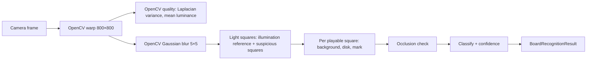

# Recognition

Implements `docs/execution-specification.md` §5 (Recognition), §7 (MVP recognition, Frame quality), §9 (`PROCESS_FRAME`), §10 (manual correction) and §14. Epic E3.

## Pipeline (vision worker)

The `FrameScheduler` from E1 drives recognition: one frame in flight, a 200 ms interval, and stale frames dropped. The vision worker acts as the processor. The page sends the saved calibration again whenever the frame size changes.

## Features (per playable square, normalized image)

| Region               | Definition (relative to square size `s`) | Used for                                           |
| -------------------- | ---------------------------------------- | -------------------------------------------------- |
| Background (corners) | distance from center ≥ 0.47 s            | the board itself, with the piece's own lighting    |
| Piece disk           | distance ≤ 0.30 s                        | foreground fraction                                |
| King mark            | distance ≤ 0.10 s                        | mark luminance                                     |
| Body                 | 0.16 s – 0.30 s                          | piece luminance without the mark                   |
| Light-square ROI     | square inset by 15 % per edge            | illumination reference, occlusion of light squares |

- **Foreground fraction:** the share of disk pixels whose RGB distance from the median background color exceeds `pixelForegroundDistance × local light reference`. Scaling by the light reference keeps the test meaningful in dim light.
- **Local light reference:** the median luminance of the 2–4 orthogonally adjacent light squares, excluding suspicious ones. Light squares never hold pieces.

## Classification

1. **Occlusion:** a square is `UNKNOWN` when its background's chromaticity or its background/light ratio departs from the board's typical dark square (hand, object, misalignment). A covered square must never read as "empty", because that would be false move evidence.
2. **Presence:** the square is empty when the foreground is ≤ 15 %, occupied when it is ≥ 45 %, and `UNKNOWN` in between (off-square piece, finger).
   - If the square's background is darker than 22 % of the light reference, a black piece could be invisible, so "empty" becomes `UNKNOWN` and a `LOW_BOARD_CONTRAST` warning is raised.
3. **Color:** piece body vs square background luminance ratio. The piece is white at ≥ 1.5, black at ≤ 0.65, and `UNKNOWN` in between. Both regions share the same lighting, which makes this robust to gradients and shadows.
4. **King:** the contrast between the king mark and the body, relative to the light reference, must be ≥ 0.25.
   - **Assumption (spec §7):** kings are standardized pieces with a distinct central mark (sticker, crown, contrasting cap). Unmarked or stacked kings are not detected, so the user corrects them manually.
5. **Confidence:** each decision gives 0.5 at its threshold, rising linearly to 1 at its soft margin. The square's confidence is the weakest of its decisions, and below 0.60 the square becomes `UNKNOWN`. These are heuristic values, not probabilities. The bands are high ≥ 0.95, acceptable ≥ 0.80, uncertain ≥ 0.60 (spec §7).

**Board result:**

- 64 cells: non-playable cells are always `EMPTY` with confidence 1.
- 32 `SquareRecognition`s.
- `overallConfidence` is the mean over the playable squares.
- `status` is `UNCERTAIN` if any square is `UNKNOWN` or below 0.80, `SUCCESS` otherwise. (`ERROR` is reserved; worker failures arrive as protocol `ERROR`s.)

**Warnings:**

- `UNKNOWN_SQUARES`, `LOW_CONFIDENCE`, `UNEXPECTED_OBJECTS`, `LOW_BOARD_CONTRAST`, `TOO_MANY_PIECES` (more than 12 of a color);
- advisory frame quality: `LOW_SHARPNESS`, `UNDEREXPOSED`, `OVEREXPOSED`. These never reject a frame.

All thresholds live in `vision/recognition/classifier.config.ts`. They travel in `VisionConfig.classifier`, keep the spec's `Record<string, number>` shape, are typed, and are validated at `INIT`.

## Correction workflow (`/recognition`)

**Pause and correct** freezes the current reading. The user then:

1. selects a square on the digital board and picks _Empty / White / Black / White king / Black king_;
2. sees corrected squares marked on the board;
3. can **undo corrections** to revert them.

**Confirm position** requires every square to be known. Corrected squares get confidence 1.

The confirmed observation stays in the page store; it is not game state. E6 will use it as the initial position, after engine validation.

**Measurable (Gate G3):** while correcting, the page shows _Automatic reading: N of 32 squares correct (X %) · K corrected_. That gives a per-session accuracy figure on real boards, to feed the physical test matrix (E8-T02).

## Measured results (synthetic, 2026-11-19)

These were measured with `tests/fixtures/synthetic-board.ts`, top-down 800 × 800, with default thresholds. Synthetic data validate the logic, not real-world accuracy.

| Scenario                                             |           Correct | UNKNOWN | Wrong |
| ---------------------------------------------------- | ----------------: | ------: | ----: |
| Ideal, starting position / mid-game with kings       |             32/32 |       0 |     0 |
| Dim ×0.55 / ×0.35 / ×0.25                            |             32/32 |       0 |     0 |
| Bright ×1.2 / ×1.5 (clipping)                        |             32/32 |       0 |     0 |
| Lighting gradient 0.6→1.15 / 0.4→1.2                 |             32/32 |       0 |     0 |
| Noise σ 10                                           |             32/32 |       0 |     0 |
| Pieces off-center ±8 % / ±15 %                       |             32/32 |       0 |     0 |
| Shadow ×0.6                                          |             32/32 |       0 |     0 |
| Shadow ×0.4                                          |             28/32 |       4 |     0 |
| Gradient + noise + jitter                            |             32/32 |       0 |     0 |
| Green/cream board                                    |             32/32 |       0 |     0 |
| Near-black dark squares (unsupported board)          |              8/32 |      24 |     0 |
| Red/white pieces on brown (default thresholds)       |             24/32 |       8 |     0 |
| Through the worker (perspective, OpenCV): noise σ 20 | ≥ 95 % (asserted) |       — |     0 |

**No scenario produced a confident wrong answer.** The worker pipeline tests (`tests/integration/recognition-pipeline.spec.ts`) read 32/32 under perspective in three orientations. In Chromium, the E2E fake camera plays a generated board video and the page reads 32/32, kings included (`tests/e2e/recognition.spec.ts`). `recognizeBoard` takes about 3 ms per frame in Node.

Before reaching that point, the measurements uncovered three bugs, which were fixed: confident "empty" under a hand, confident "empty" for black pieces on near-black squares, and confident errors in very dim light (absolute foreground threshold).

## First real-world test (2026-11-19) and validation with real samples

The first test was a blue/cream board with tall grooved pieces and an oblique camera in daylight. It showed 11 `?` and 3 low-confidence squares, with **no confident wrong answer**. I first read the dashed amber rings on d2, h2 and g3 as false kings; they were low-confidence white men.

**Analysis:**

- **Main cause: imprecise corners on the far edge.** Synthetic reproduction shows that a 10 px inset of the far corners alone produces 11 `?`.
- **Fix:** automatic corner adjustment (ADR-027), plus a "Reajustar cantos" button on the recognition screen.
- **Diagnostics:** the board now shows the reason for every `?`.

**Validation workflow with real boards (ADR-028):**

1. Confirm the position on `/recognition`.
2. Click **Baixar amostra rotulada**.
3. Add the JSON to `tests/fixtures/real-samples/` and register it in `index.ts`.

`npm test` then replays it through the real pipeline, both as saved and after automatic adjustment, and fails on confident errors or regressions.

The synthetic renderer now also models the real set: tall pieces in oblique perspective, grooves with a dark center, cast shadows, stacked kings, and the blue board (`REAL_SET_BLUE_BOARD`).

## Known limitations (to address with physical data)

- **Pieces whose luminance is close to the dark squares** (for example red pieces on brown squares) come out as `UNKNOWN`. Tune `blackMaxContrastRatio` (for example 0.85) for such sets.
- **Kings must carry a central mark.** Stacked (unmarked) kings read as men; the engine will track promotions (E4/E6), so this matters mainly for the initial position, which the user corrects.
- **There is no temporal smoothing yet** (E5: stabilizer). Each frame is classified independently.
- **Thresholds come from synthetic boards only.** The physical test matrix (E8-T02) must validate them: lighting, angles, real pieces, occlusion.
